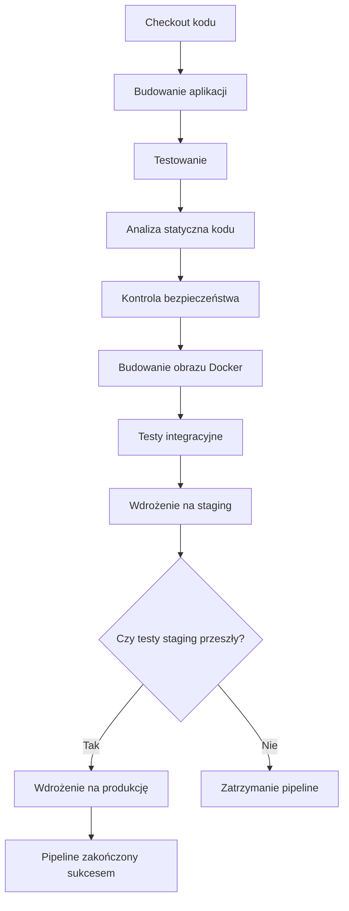

# Diagram pipeline CI/CD w Jenkins

## Diagram Mermaid

## Opis

Diagram przedstawia typowy proces CI/CD w Jenkinsie dla aplikacji webowej.

Pipeline rozpoczyna się od pobrania kodu z repozytorium, a następnie przechodzi przez budowanie aplikacji, testowanie, analizę kodu i kontrolę bezpieczeństwa.

Po pomyślnym zakończeniu tych etapów budowany jest obraz Docker i wykonywane są testy integracyjne.

Następnie aplikacja jest wdrażana na środowisko staging.

Jeżeli testy na staging zakończą się sukcesem, następuje wdrożenie na produkcję. W przeciwnym przypadku pipeline zostaje zatrzymany.
